# Arquitetura do Sistema VulcanTech-OEE

## 1. Visão Geral Executiva

O **VulcanTech-OEE** é uma plataforma industrial integrada de Inteligência Artificial aplicada à manufatura aditiva e usinagem de alta precisão de ligas metálicas nobres (Aço Carbono 316L, Alumínio 7075 e Liga de Titânio Ti-6Al-4V) para a empresa fictícia **VulcanTech Smart Metals S.A.**.

A solução conecta o chão de fábrica (sensores e CLPs) à camada gerencial (MES/SCADA), unificando quatro pilares tecnológicos:
1. **Engenharia de Dados Industriais:** Tratamento de ruídos, sentinelas e enriquecimento de features operacionais.
2. **Manutenção Preditiva & Detecção de Anomalias:** Classificação supervisionada multiclasse e Isolation Forest com recall > 99%.
3. **Visão Computacional Aplicada:** Inspeção dimensional de cordões de solda via OpenCV (Canny/porosidade) e termografia em espaço de cor HSV (ZAC/HAZ).
4. **Eficiência Global (OEE) e Controle em Malha Fechada:** Decomposição fatorial $OEE = A \times P \times Q$, quantificação financeira de downtime e atuação em 5 níveis de segurança de CLP.

---

## 2. Diagrama Arquitetural em Camadas

```mermaid
flowchart TD
    subgraph CAMADA_0_1["Camada 0 & 1 — Chão de Fábrica & Sensores (OT)"]
        S1["Termopar Spindle (°C)"]
        S2["Acelerômetro Triaxial (mm/s)"]
        S3["Torquímetro Fuso (Nm)"]
        S4["Sensor de Vazão (L/min)"]
        S5["Transformador de Corrente (A)"]
        S6["Transdutor Pressão (bar)"]
        S7["Sonômetro Industrial (dB)"]
        CAM["Câmera Óptica & Termográfica FLIR"]
        PLC["CLP / PLC Industrial (IEC 61131 / ISO 13849)"]
    end

    subgraph CAMADA_2["Camada 2 — Controle & Edge Gateway"]
        GW["Edge Gateway / Agente de Telemetria"]
        PLC_CTRL["Módulo de Controle Malha Fechada (plc_controller.py)"]
    end

    subgraph CAMADA_3["Camada 3 — Backend API & Inteligência Artificial (IT)"]
        API["FastAPI RESTful Hub (42 endpoints)"]
        DB[(Banco SQLite / Persistência)]
        FEAT["Pipeline & Feature Engineering (IEM, Rolling, Z-Score)"]
        ML_SUP["Classificador Multiclasse (Random Forest / XGBoost)"]
        ML_UNSUP["Detector de Anomalias (Isolation Forest)"]
        CV_GEOM["Inspeção Geométrica (OpenCV Canny/Contornos)"]
        CV_THERM["Análise Termográfica (OpenCV HSV/HAZ)"]
        OEE_ENG["Motor de Cálculo OEE & Impacto Preditivo"]
    end

    subgraph CAMADA_4["Camada 4 — Supervisão & Gestão (SCADA / MES)"]
        ST["Streamlit Industrial Cockpit (9 Páginas Especializadas)"]
        P1["1. Dashboard Geral"]
        P2["2. Monitoramento Tempo Real"]
        P3["3. Manutenção Preditiva"]
        P4["4. OEE e Eficiência"]
        P5["5. Visão Computacional"]
        P6["6. Análise de Dados (EDA)"]
        P7["7. Modelos de IA"]
        P8["8. Simulador Industrial"]
        P9["9. Parecer Técnico"]
    end

    S1 & S2 & S3 & S4 & S5 & S6 & S7 --> GW
    CAM --> GW
    GW --> API
    API --> DB
    API --> FEAT
    FEAT --> ML_SUP & ML_UNSUP
    API --> CV_GEOM & CV_THERM
    API --> OEE_ENG
    ML_SUP & ML_UNSUP --> PLC_CTRL
    PLC_CTRL -->|Comandos Nível 0 a 4 / E-Stop| PLC
    API --> ST
    ST --> P1 & P2 & P3 & P4 & P5 & P6 & P7 & P8 & P9
```

---

## 3. Modelo Purdue e Segregação OT / IT

Em conformidade com a norma **ANSI/ISA-95** e **IEC 62443**:

| Nível | Função | Componente VulcanTech | Protocolos |
|---|---|---|---|
| **Nível 0** | Processo Físico | 4 Células de Usinagem (`CEL-201` a `CEL-204`) | Sinais analógicos 4-20mA, 0-10V |
| **Nível 1** | Controle Básico | CLP / PLC de Segurança e Intertravamento | Modbus TCP, Entradas Digitais |
| **Nível 2** | Controle de Área | Supervisório de Célula e Edge Gateway | TCP/IP Industrial, Sockets |
| **Nível 3** | Gestão de Operações (MES) | FastAPI, Modelos de ML e Pipeline de Dados | RESTful JSON, HTTP/2, SQLite |
| **Nível 4** | Gestão Corporativa | Streamlit Web Dashboard (Cockpit SCADA) | WebSockets, HTTPS |

---

## 4. Tecnologias Utilizadas

- **Linguagem Principal:** Python 3.11 / 3.14
- **Backend API:** FastAPI, Uvicorn, Pydantic v2, HTTPX
- **Frontend SCADA:** Streamlit, Streamlit Option Menu, Plotly Express & Graph Objects
- **Data Engineering:** Pandas 2.x, NumPy, PyArrow (Parquet)
- **Machine Learning:** Scikit-Learn, XGBoost, Imbalanced-Learn, Joblib
- **Visão Computacional:** OpenCV (cv2 headless), Pillow
- **Banco de Dados:** SQLite 3 (com schema normalizado e integridade referencial)
- **Infraestrutura:** Docker, Docker Compose, PowerShell Core

