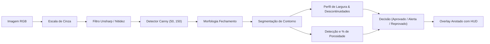
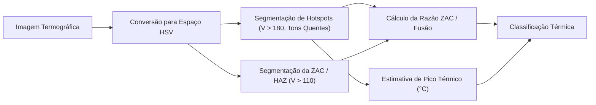

# Visão Computacional Aplicada à Inspeção de Soldas

## 1. Visão Geral

A etapa de controle de qualidade automatizado da VulcanTech emprega técnicas avançadas de Visão Computacional com **OpenCV** para avaliação não destrutiva de juntas soldadas. O pipeline abrange duas modalidades complementares:
1. **Inspeção Geométrica e Porosidade (Imagens Visuais Convencionais)**
2. **Análise Termográfica da Zona Afetada pelo Calor (Imagens Térmicas em Falsa Cor)**

---

## 2. Inspeção Geométrica do Cordão de Solda (`weld_inspection.py`)

Em conformidade com as normas **ISO 5817** (Níveis de qualidade de imperfeições em juntas soldadas) e **AWS D1.1**:

### 2.1. Métricas Extraídas:
- **Área do cordão (`area_cordao_px`)**
- **Perfil de largura transversal:** Média, Mínima, Máxima e Variação percentual ($\sigma / \mu \times 100$)
- **Contagem de cavidades/poros:** Detecção de descontinuidades escuras circulares com $4\pi A / P^2 \ge 0.35$
- **Porosidade percentual:** $(\text{Área Poros} / \text{Área Cordão}) \times 100$

### 2.2. Critérios de Julgamento:
- **APROVADO:** Porosidade $< 1.0\%$, variação de largura $< 20\%$ e ausência de estreitamentos.
- **ALERTA:** Porosidade entre $1.0\%$ e $3.0\%$ ou variação moderada de largura.
- **REPROVADO:** Porosidade $\ge 3.0\%$ ou descontinuidades críticas de falta de fusão.

---

## 3. Análise Termográfica e ZAC/HAZ (`thermal_analysis.py`)

A termografia infravermelha monitora a distribuição de calor durante a solidificação da poça de fusão:

### 3.1. Segmentação no Espaço HSV:
- **Hotspot / Poça de Fusão:** Alta saturação e brilho ($V > 180$, matiz $H < 35$ ou $H > 160$, ou núcleo incandescente branco).
- **Zona Afetada pelo Calor (ZAC / HAZ):** Halo térmico intermediário ($V > 110$, tons amarelo/alaranjado/magenta).

### 3.2. Diagnósticos Térmicos Emitidos:
- **CONFORME (Aprovado):** Poça de fusão contínua com ZAC proporcional ($\text{ZAC} \le 40\%$).
- **SUBAQUECIMENTO / FALTA DE FUSÃO (Reprovado):** Hotspot quase inexistente ($< 15.000$ pixels). Risco severo de trinca a frio e falta de penetração.
- **SUPERAQUECIMENTO CRÍTICO (Reprovado):** $\text{ZAC} > 40\%$, com risco de crescimento excessivo de grão metalúrgico e perda de tenacidade.

