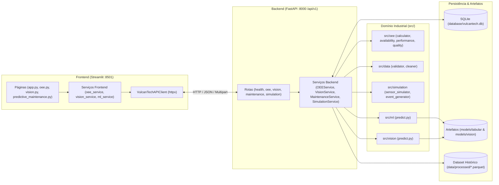

# Arquitetura da API — VulcanTech Smart Metals S.A.

## 1. Visão Geral

A arquitetura do ecossistema **VulcanTech Smart Metals S.A.** segue o padrão de camadas desacopladas, separando:
1. **Camada de Domínio e Modelos (`src/`)**: Regras de negócio industriais puras (OEE ponderado, validação e limpeza de telemetria, simulação controlada, inferência de ML tabular e Visão Computacional).
2. **Camada de Persistência (`database/`)**: Banco de dados relacional SQLite (`database/vulcantech.db`) com rastreamento explícito da origem de cada registro (`data_source`: `historical`, `simulated`, `api`).
3. **Camada de Serviços e Rotas HTTP (`backend/`)**: API REST construída em FastAPI com versionamento explícito sob `/api/v1`, validação estrita via Pydantic v2, tratamento padronizado de erros e injeção de dependências (`Depends`).
4. **Camada de Apresentação (`frontend/`)**: Aplicação multipágina em Streamlit conectada exclusivamente via cliente HTTP centralizado (`frontend/services/api_client.py`), sem acesso direto ao banco ou aos artefatos `.joblib`.

---

## 2. Organização Modular do Repositório

| Diretório / Arquivo | Responsabilidade |
|---|---|
| `src/oee/` | Cálculo matemático determinístico e ponderado de Disponibilidade, Performance, Qualidade e OEE Global. |
| `src/data/` | Validação de faixas operacionais, detecção de códigos sentinela (`999.9`, `-99.0`, `-1.0`) e higienização auditável de leituras. |
| `src/simulation/` | Geração sintética controlada de leituras de sensores e turnos produtivos nos modos `NORMAL`, `DEGRADACAO`, `FALHA` e `MISTO`. |
| `src/ml/` | Pipeline tabular original (pré-processamento, engenharia de variáveis e inferência contemporânea de falha com `best_model.joblib`). |
| `src/vision/` | Pipeline de visão computacional experimental (HOG + histograma RGB + média espacial + 1-NN para imagens ópticas e térmicas). |
| `database/` | DDL SQLite (`schema.sql`), gerenciamento de conexões (`db.py`) e repositórios transacionais (`repositories.py`). |
| `backend/` | Aplicação FastAPI (`main.py`), configurações centralizadas (`config.py`), injeção de dependências (`dependencies.py`), schemas (`schemas/`) e serviços (`services/`). |
| `frontend/` | Interface Streamlit (`app.py`, `pages/`, `components/`) e camada de comunicação HTTP (`services/api_client.py`). |
| `iniciar_aplicacao.ps1` | Script PowerShell na raiz do projeto para inicializar banco SQLite, servidor FastAPI e dashboard Streamlit. |

---

## 3. Decisões Arquiteturais e Guardrails Industriais

1. **Proibição de Fabricação de Dados (Zero-Mock Policy)**:
   - O dataset histórico (`dados_sensores_vulcantech_tratados.parquet`) possui apenas telemetria de sensores, sem registros de produção ou paradas. Quando o usuário consulta `GET /api/v1/oee/summary?data_source=historical`, o backend retorna explicitamente `available=False` informando o motivo real, sem inventar números de OEE.
2. **Transparência sobre Maturidade dos Modelos**:
   - **ML Tabular**: Classifica a condição **contemporânea** da leitura (`tipo_falha` 0 a 3) sem afirmar horizonte temporal futuro (RUL), pois o dataset não possui timestamp.
   - **Visão Computacional**: Identificada em todas as respostas da API e na interface Streamlit com `experimental=True` e `validated_for_industrial_use=False`, refletindo que os modelos `.joblib` foram treinados apenas com 4 imagens semente (`data/raw/imagens/`).
3. **Separação Estrita de Origem (`data_source`)**:
   - Todas as tabelas operacionais do SQLite possuem a coluna `data_source` com restrição `CHECK (data_source IN ('historical', 'simulated', 'api'))`, permitindo filtrar ou limpar dados sintéticos sem afetar registros reais enviados via API.

