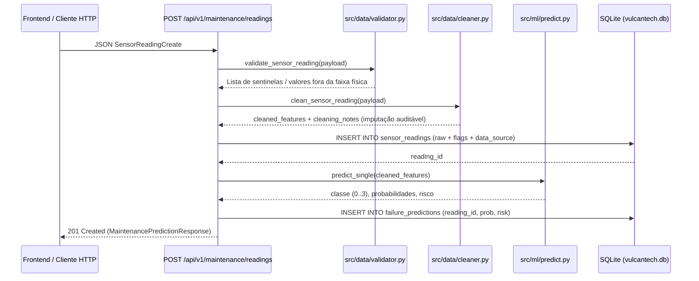

# Fluxos de Dados — VulcanTech Smart Metals S.A.

## 1. Fluxo de Telemetria, Higienização e Inferência Tabular

Quando uma leitura de sensores chega via `POST /api/v1/maintenance/readings` ou via gerador de simulação (`POST /api/v1/simulation/step`), ela percorre um pipeline determinístico de 5 etapas:



### Tratamento de Códigos Sentinela Documentados
Conforme identificado em `notebooks/limpeza.ipynb`, sensores industriais da planta podem emitir códigos sentinela de falha de transdutor:
- `temperatura_fuso_c = 999.9` → substituído pela mediana operacional (`72.5 °C`), marcando `sentinel_detected = True` e `cleaning_applied = True`.
- `vibracao_triaxial_rms_mms = -99.0` → substituído pela mediana operacional (`2.15 mm/s`).
- `pressao_hidraulica_bar = -1.0` → substituído pela mediana operacional (`150.0 bar`).

O registro bruto é preservado em `sensor_readings` com as flags `cleaning_applied` e `sentinel_detected`, garantindo rastreabilidade completa antes da inferência pelo modelo `LogisticRegression` (`models/tabular/best_model.joblib`).

---

## 2. Fluxo de Cálculo de OEE e Separação por Fonte (`data_source`)

```mermaid
flowchart TD
    Req["GET /api/v1/oee/summary?data_source=..."] --> CheckSource{"data_source == 'historical'?"}
    CheckSource -->|Sim| NoOEE["Retorna available=False (Dataset histórico possui apenas sensores)"]
    CheckSource -->|Não ('simulated', 'api', 'all')| QueryDB["Consulta production_events no SQLite"]
    QueryDB --> HasEvents{"Existem eventos?"}
    HasEvents -->|Não| EmptyOEE["Retorna available=False (Aguardando eventos de produção)"]
    HasEvents -->|Sim| CalcOEE["src/oee/calculator.py: calculate_batch_oee()"]
    CalcOEE --> Weighted["Soma ponderada de tempos e peças + Pareto de paradas"]
    Weighted --> Resp["Retorna OEESummaryResponse (200 OK)"]
```

- **Por que somas ponderadas?** A média aritmética simples de percentuais de turnos com durações ou volumes diferentes distorce o OEE real da planta. O módulo `src/oee/calculator.py` agrega `operating_time_min`, `planned_time_min`, `ideal_time_min`, `good_units` e `total_units` antes de extrair os índices globais.

---

## 3. Fluxo de Inspeção por Visão Computacional

1. O usuário seleciona a modalidade (`visual` ou `termica`) e envia uma imagem (`PNG`, `JPG` ou `WEBP`) na página `frontend/pages/vision.py` (ou escolhe uma das 4 imagens semente de `data/raw/imagens/`).
2. O cliente HTTP envia um `multipart/form-data` para `POST /api/v1/vision/predict`.
3. O backend valida tamanho (máx. 10 MB), MIME type e integridade binária via Pillow (`Image.verify()`).
4. A imagem é salva temporariamente em `database/uploads/`, processada por `src/vision/predict.py` (descritor HOG + histograma RGB + média 4x4 + 1-NN) e removida em bloco `finally`.
5. O resultado é gravado na tabela `vision_predictions` do SQLite e retornado ao frontend acompanhado do aviso explícito de modelo experimental (`experimental=True`, `validated_for_industrial_use=False`).

